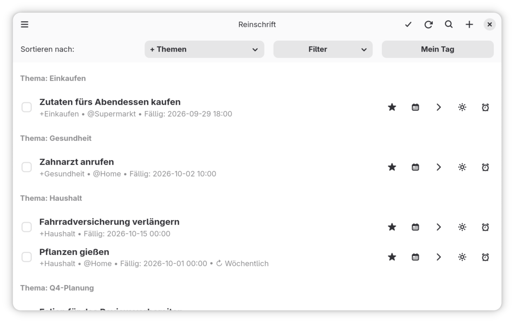

# Reinschrift

> 🇬🇧 [English version](README.md)

Verwalte deine Aufgaben in reinem Markdown — mit einer nativen GNOME-Desktop-App, einer GNOME-Shell-Erweiterung, einer CLI und einer selbst hostbaren Web-App.

Reinschrift kombiniert eine native GNOME-Oberfläche mit der Einfachheit von reinem Text. Deine Aufgaben bleiben eine ganz normale Markdown-Datei: leicht zu sichern, per Git versionierbar und auf jedem Gerät mit deinem Lieblingseditor editierbar. Die App synchronisiert die Datei über Nextcloud/WebDAV, liest Änderungen live ein und schreibt direkt zurück — klassische To-do-Listen im Klartext, alltagstauglich gemacht, ohne proprietäre Silos.



## Das Aufgabenformat

Jede Aufgabe ist eine Zeile Markdown:

```markdown
- [ ] Aufgabentitel +projekt @ort due:2026-01-20 rec:weekly ~note:"Weitere Details" ^ID123
- [x] Erledigte Aufgabe ✅ 2026-01-15
```

| Token | Bedeutung |
|---|---|
| `+projekt` | Projekt (Anführungszeichen erlaubt: `+"Großes Projekt"`) |
| `@ort` | Kontext / Ort |
| `due:YYYY-MM-DD` | Fälligkeitsdatum, optional mit Uhrzeit (`due:2026-01-20T14:00`); `due:9999-12-31` heißt „Irgendwann“ |
| `rec:weekly` | Wiederholung: `daily`, `weekly` oder `monthly` (beim Abschließen wird die nächste angelegt) |
| `myday:YYYY-MM-DD` | Für „Mein Tag“ an diesem Datum eingeplant |
| `~note:"…"` | Freitext-Notiz |
| `^ID123` | Stabile Referenz-ID (wird automatisch vergeben) |

## Funktionen

- **Plain Text zuerst** — eine Markdown-Datei, keine Datenbank, kein Lock-in
- **WebDAV/Nextcloud-Sync** — oder eine lokale Datei; externe Änderungen werden live erkannt
- **Mein Tag** — tägliche Aufgabenplanung: wähle aus, was du heute erledigen willst, auch direkt aus der GNOME-Leiste
- **Suche, Filter, Sortierung** — die Suche umfasst Titel, Projekt, Ort und Notiz; Filter nach Zeitraum, Projekten und Orten; Sortierung nach Projekt, Ort oder Fälligkeit
- **Wiederkehrende Aufgaben** — `rec:daily`, `rec:weekly`, `rec:monthly`
- **Rückgängig** — destruktive Aktionen lassen sich zurücknehmen (Desktop, Web, `reinschrift undo`)
- **Spracheingabe** — lokale Transkription per Whisper (Desktop) bzw. Web Speech API (Web)
- **KI-Aufgabenerkennung** — natürliche Sprache wird per Ollama/LLM in strukturierte Aufgaben übersetzt (optional)
- **Extras der Web-App** — als PWA installierbar, Push-Erinnerungen, Freigabelinks für ein einzelnes Projekt oder einen Ort, CalDAV-Sync mit iOS-Erinnerungen
- **Sechs Sprachen** — Deutsch, Englisch, Spanisch, Französisch, Japanisch, Schwedisch

## Apps und Einstieg

Alle Apps arbeiten mit derselben Markdown-Datei. Nimm die, die du brauchst — sie laufen problemlos nebeneinander.

| App | Installation | Woher die Aufgabendatei kommt |
|---|---|---|
| [Desktop-App](#desktop-app) | Flathub, AUR, aus den Quellen | Wird automatisch angelegt oder in den *Einstellungen* gewählt (lokale Datei oder Nextcloud/WebDAV) |
| [GNOME-Shell-Erweiterung](#gnome-shell-erweiterung) | aus diesem Repository | Nimmt automatisch die Datei der Desktop-App |
| [CLI](#cli) | kommt mit der Desktop-App; aus den Quellen | Nutzt die Einstellungen der Desktop-App oder `--database` |
| [Web-App](#web-app-selbst-gehostet) | Docker-Image | Umgebungsvariablen (`TODOS_DB_PATH` oder `WEBDAV_*`) |
| [iOS-Erinnerungen](#ios-erinnerungen-caldav) | über die Web-App | Die Datei der Web-App |

### Desktop-App

<a href="https://flathub.org/apps/me.dumke.Reinschrift"></a>

```bash
flatpak install flathub me.dumke.Reinschrift   # Flathub
yay -S reinschrift                              # Arch Linux (AUR), oder ein anderer AUR-Helfer
```

**Erster Start:** Reinschrift legt eine leere Aufgabendatei an (`~/.local/share/reinschrift_todo/todos.md`, beim Flatpak unter `~/.var/app/me.dumke.Reinschrift/data/`), du kannst also sofort Aufgaben anlegen. Für eine eigene Datei öffne im Hauptmenü die *Einstellungen*:

- **Lokale Datei** — unter *Datenbankdatei* wählst du eine vorhandene Datei (z. B. in deinem Nextcloud- oder Syncthing-Ordner) oder erstellst eine neue.
- **Nextcloud/WebDAV** — schalte *WebDAV verwenden* ein und nutze entweder *Mit Nextcloud anmelden* (Serveradresse eingeben, im Browser bestätigen — das App-Passwort wird für dich erzeugt) oder trage WebDAV-URL, Benutzername und Passwort von Hand ein. *Pfad (relativ)* ist die Datei auf dem Server (Standard `todos.md`).

Spracheingabe (Whisper) und KI-Erkennung (Ollama) sind ab Werk aus und lassen sich im selben Dialog einschalten. Im Hauptmenü findest du außerdem *Tastenkürzel* und *Feedback senden*.

### GNOME-Shell-Erweiterung

Zeigt deinen „Mein Tag“ in der oberen Leiste: heutige Aufgaben abhaken, Details öffnen, verschieben und neue anlegen, ohne die App zu öffnen. Unterstützt GNOME 48–51.

Die Erweiterung wartet noch auf die Prüfung bei extensions.gnome.org. Bis dahin installierst du sie aus dem Repository:

```bash
git clone https://github.com/danst0/ReinschriftTodo
ReinschriftTodo/extension/install.sh
```

Unter Wayland einmal ab- und wieder anmelden, dann mit `gnome-extensions enable reinschrift@dumke.me` (oder in der App *Erweiterungen*) einschalten. Einzurichten ist nichts: Die Erweiterung findet die Datei, die die Desktop-App nutzt (Flatpak oder nativ). Synchronisiert die App per WebDAV, liest die Erweiterung die Kopie des Nextcloud-Desktop-Clients unter `~/Nextcloud/<Pfad>`. Alles andere — etwa wenn du nur die Web-App nutzt — wählst du in den Einstellungen der Erweiterung. Details: [extension/README.md](extension/README.md) (englisch).

### CLI

Die CLI teilt die Einstellungen der Desktop-App und arbeitet daher ohne weitere Einrichtung mit derselben Datei (lokal oder WebDAV):

```bash
flatpak run --command=reinschrift-cli me.dumke.Reinschrift list   # Flatpak
reinschrift-cli list                                              # AUR
reinschrift list                                                  # aus den Quellen gebaut (target/release/reinschrift)
```

Tipp fürs Flatpak: `alias reinschrift='flatpak run --command=reinschrift-cli me.dumke.Reinschrift'`. Ohne Desktop-App zeigst du der CLI die Datei mit `--database PFAD` (für einen Aufruf) oder `TODOS_DB_PATH` (gilt, solange kein Pfad gespeichert ist); die Einstellungen selbst liegen in `~/.config/reinschrift_todo/preferences.json`. `reinschrift config show` zeigt, was gerade gilt.

```
reinschrift [OPTIONEN] <BEFEHL>

OPTIONEN:
        --database <PFAD>    Markdown-Datenbank für diesen Aufruf (übersteuert gespeicherten Pfad/WebDAV, wird nicht gespeichert)
    -l, --language <SPRACHE> Sprache (de, en, es, fr, ja, sv)
    -j, --json               JSON-Ausgabe für Skripte
        --no-color           Farbausgabe deaktivieren

BEFEHLE:
    list (ls)       Aufgaben auflisten (mit Filter/Sortierung)
                    (--sort topic|location|date, --due any|overdue|today|tomorrow|week|month|undated,
                     --undated, --project, --context, --all)
    add             Neue Aufgabe anlegen
    edit            Aufgabe bearbeiten
    delete (rm)     Aufgabe(n) löschen
    done            Als erledigt markieren
    undone          Als offen markieren
    today           Fälligkeit auf heute setzen
    tomorrow        Fälligkeit auf morgen setzen
    undo            Letzte destruktive Aktion rückgängig machen
    search          Aufgaben durchsuchen
    feedback        Vorausgefüllte Links für GitHub-Issue und E-Mail ausgeben
    config          Konfiguration anzeigen, WebDAV-Verbindung testen
```

Beispiele:

```bash
reinschrift add "Blumen gießen +zuhause @garten due:2026-06-05 rec:weekly"
reinschrift list --sort date --due week
reinschrift done ^ID123
```

### Web-App (selbst gehostet)

Bei jedem Release wird ein fertiges Image auf GHCR veröffentlicht — kein lokales Bauen nötig:

```bash
git clone https://github.com/danst0/ReinschriftTodo && cd ReinschriftTodo/webapp
cp docker-compose.example.yml docker-compose.yml   # SECRET_KEY, Zugangsdaten, TZ … setzen
touch ../TodosDatenbank.md                         # die Aufgabendatei muss vor dem ersten Start existieren
docker compose up -d                               # zieht ghcr.io/danst0/reinschrift-web:latest
```

Öffne `http://localhost:5000` und melde dich mit `APP_USER`/`APP_PASSWORD` an (oder per OIDC). Verfügbare Tags: `latest` sowie eines pro Release (z. B. `1.2.3`). Alles — Login, OIDC, WebDAV statt lokaler Datei, Push-Erinnerungen, CalDAV — wird über Umgebungsvariablen eingestellt; [webapp/README.md](webapp/README.md) (englisch) listet sie alle auf und erklärt HTTPS, die PWA und die lokale Entwicklung.

### iOS-Erinnerungen (CalDAV)

Die Web-App kann deine Aufgaben an die Erinnerungen-App des iPhones ausliefern. Setze `CALDAV_ENABLED=true` (optional `CALDAV_USER`/`CALDAV_PASSWORD`), mach die Web-App per HTTPS erreichbar und gehe auf dem iPhone zu *Einstellungen → Apps → Erinnerungen → Accounts → Account hinzufügen → Andere → CalDAV-Account hinzufügen*; Server `https://deine-domain/caldav/`, dazu Benutzer und Passwort. Die Einstellungsseite der Web-App zeigt die genauen Werte. Alle Aufgaben stehen in einer Liste „Reinschrift“, Projekte als Hashtags und Orte hinter dem Titel (`Rasen mähen #Garten @Daheim`). Siehe [webapp/README.md](webapp/README.md#ios-reminders-caldav).

### Aus den Quellen bauen

Voraussetzungen: Rust-Toolchain, GTK4- und libadwaita-Entwicklungsbibliotheken (`libgtk-4-dev`, `libadwaita-1-dev` o. ä.), `cmake` und `clang` (für die Whisper-Spracheingabe), `gettext` (`msgfmt`, für die Übersetzungen).

```bash
cargo build --workspace --release
# Binaries:
#   target/release/reinschrift_todo   (GUI)
#   target/release/reinschrift        (CLI)
```

## Komponenten

Dieses Repository ist ein Cargo-Workspace plus eine Python-Web-App und eine GNOME-Shell-Erweiterung:

| Verzeichnis | Inhalt |
|---|---|
| `core/` | Gemeinsame Rust-Bibliothek: Parsing, Rendering, Speicher (lokal + WebDAV), Geschäftslogik |
| `gui/` | Native GNOME-App (GTK4/libadwaita) |
| `cli/` | Kommandozeilen-Interface |
| `extension/` | GNOME-Shell-Erweiterung (GJS) |
| `webapp/` | Flask-Web-App (Docker, OIDC-Login, PWA, Push, CalDAV) |
| `po/` | Übersetzungen der Rust-Apps (gettext, siehe [po/README.md](po/README.md)) |

## Feedback

Fehler gefunden oder eine Idee? Nutze *Feedback senden* im Hauptmenü der App, in den Einstellungen der Web-App oder `reinschrift feedback` — damit wird ein [GitHub-Issue](https://github.com/danst0/ReinschriftTodo/issues) oder eine E-Mail mit Version und Systemangaben vorausgefüllt.

## Entwicklung

```bash
# GUI aus den Quellen starten
cargo run -p reinschrift-gui --release

# Eigene Datenbankdatei verwenden
TODOS_DB_PATH=/pfad/zur/db.md cargo run -p reinschrift-gui

# CLI ausführen
cargo run -p reinschrift-cli -- list
```

Git-Hooks aktivieren, damit vor jedem Commit `cargo check --locked --workspace` läuft (mit `SKIP_CARGO_CHECK=1` einmalig überspringen):

```bash
git config core.hooksPath .githooks
```

### Tests

```bash
# Rust
cargo test --workspace

# Web-App
cd webapp
pip install -r requirements.txt -r requirements-dev.txt
pytest tests/ -v
mypy app/

# Shell-Erweiterung (Paritätstests des Zeilenformats gegen den Rust-Core)
gjs -m extension/tests/run.js
```

## Verhaltenskodex

Dieses Projekt folgt dem [GNOME Code of Conduct](https://conduct.gnome.org/) — siehe [CODE_OF_CONDUCT.md](CODE_OF_CONDUCT.md).

## Lizenz

[GPL-3.0-or-later](LICENSE)
