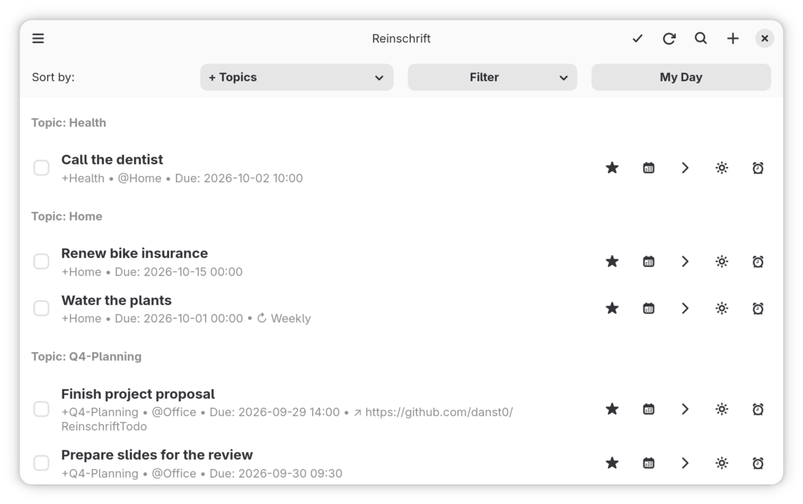

# Reinschrift

> 🇩🇪 [Deutsche Version](README.de.md)

Manage your todos in plain Markdown — with a native GNOME desktop app, a GNOME Shell extension, a CLI, and a self-hostable web app.

Reinschrift combines a native GNOME interface with the simplicity of plain text. Your tasks remain a normal Markdown file: easy to back up, versionable via Git, and editable on any device with your favorite editor. The app syncs the file via Nextcloud/WebDAV, reads changes live, and writes directly back — classic plain-text to-do lists, made suitable for everyday use, without proprietary silos.



## The todo format

Each task is one line of Markdown:

```markdown
- [ ] Task title +project @context due:2026-01-20 rec:weekly ~note:"Additional details" ^ID123
- [x] Completed task ✅ 2026-01-15
```

| Token | Meaning |
|---|---|
| `+project` | Project (quotes allowed: `+"Big Project"`) |
| `@context` | Context / place |
| `due:YYYY-MM-DD` | Due date, optionally with time (`due:2026-01-20T14:00`); `due:9999-12-31` means "sometime" |
| `rec:weekly` | Recurrence: `daily`, `weekly` or `monthly` (the next occurrence is created on completion) |
| `myday:YYYY-MM-DD` | Planned for "My Day" on that date |
| `~note:"…"` | Free-form note |
| `^ID123` | Stable reference ID (added automatically) |

## Features

- **Plain text first** — one Markdown file, no database, no lock-in
- **WebDAV/Nextcloud sync** — or a plain local file; external changes are picked up live
- **My Day** — daily task planning: pick what you want to do today, also right from the GNOME top bar
- **Search, filtering, sorting** — search covers title, project, place and note; filter by time range, projects and places; sort by project, place or due date
- **Recurring tasks** — `rec:daily`, `rec:weekly`, `rec:monthly`
- **Undo** — destructive actions can be reverted (desktop, web, `reinschrift undo`)
- **Voice input** — local transcription via Whisper (desktop) or the Web Speech API (web)
- **AI task parsing** — turn natural language into structured tasks via Ollama/LLM (optional)
- **Web extras** — installable as a PWA, push reminders, share links for a single project or place, CalDAV sync with iOS Reminders
- **Six languages** — German, English, Spanish, French, Japanese, Swedish

## Apps and getting started

All apps work on the same Markdown file. Pick the ones you need — they can run side by side.

| App | Install | Where the todo file comes from |
|---|---|---|
| [Desktop app](#desktop-app) | Flathub, AUR, from source | Created automatically, or chosen in *Settings* (local file or Nextcloud/WebDAV) |
| [GNOME Shell extension](#gnome-shell-extension) | from this repository | Uses the desktop app's file automatically |
| [CLI](#cli) | ships with the desktop app; from source | Uses the desktop app's settings, or `--database` |
| [Web app](#web-app-self-hosted) | Docker image | Environment variables (`TODOS_DB_PATH` or `WEBDAV_*`) |
| [iOS Reminders](#ios-reminders-caldav) | via the web app | The web app's file |

### Desktop app

<a href="https://flathub.org/apps/me.dumke.Reinschrift"></a>

```bash
flatpak install flathub me.dumke.Reinschrift   # Flathub
yay -S reinschrift                              # Arch Linux (AUR), or any AUR helper
```

**First start:** Reinschrift creates an empty todo file (`~/.local/share/reinschrift_todo/todos.md`, for the Flatpak under `~/.var/app/me.dumke.Reinschrift/data/`) and you can start adding tasks right away. To use a file of your own, open *Settings* from the main menu:

- **Local file** — *Database file* lets you pick an existing file (e.g. one inside your Nextcloud or Syncthing folder) or create a new one.
- **Nextcloud/WebDAV** — switch on *Use WebDAV* and either use *Login with Nextcloud* (enter the server address, confirm in the browser — the app password is created for you) or enter the WebDAV URL, user name and password by hand. *Path (relative)* is the file on the server (default `todos.md`).

Voice input (Whisper) and AI parsing (Ollama) are off by default and can be switched on in the same dialog. The main menu also has *Keyboard Shortcuts* and *Send Feedback*.

### GNOME Shell extension

Shows your "My Day" in the top bar: tick off today's tasks, open their details, postpone them and add new ones without opening the app. Supports GNOME 48–51.

The extension is pending review on extensions.gnome.org. Until then, install it from the repository:

```bash
git clone https://github.com/danst0/ReinschriftTodo
ReinschriftTodo/extension/install.sh
```

On Wayland, log out and back in once, then enable it with `gnome-extensions enable reinschrift@dumke.me` (or in the *Extensions* app). No setup is needed: the extension finds the file the desktop app uses (Flatpak or native). If the app syncs via WebDAV, the extension reads the Nextcloud desktop client's copy under `~/Nextcloud/<path>`. Anything else — e.g. when you only use the web app — can be chosen in the extension's preferences. Details: [extension/README.md](extension/README.md).

### CLI

The CLI shares the desktop app's settings, so it works with the same file (local or WebDAV) without further setup:

```bash
flatpak run --command=reinschrift-cli me.dumke.Reinschrift list   # Flatpak
reinschrift-cli list                                              # AUR
reinschrift list                                                  # built from source (target/release/reinschrift)
```

Tip for the Flatpak: `alias reinschrift='flatpak run --command=reinschrift-cli me.dumke.Reinschrift'`. Without the desktop app, point the CLI at a file with `--database PATH` (for one call) or `TODOS_DB_PATH` (used while no path is saved); the settings themselves live in `~/.config/reinschrift_todo/preferences.json`. `reinschrift config show` prints what is in use.

```
reinschrift [OPTIONS] <COMMAND>

OPTIONS:
        --database <PATH>    Markdown database for this call (overrides saved path/WebDAV, not saved)
    -l, --language <LANG>    Language (de, en, es, fr, ja, sv)
    -j, --json               JSON output for scripting
        --no-color           Disable colored output

COMMANDS:
    list (ls)       List todos with filtering/sorting
                    (--sort topic|location|date, --due any|overdue|today|tomorrow|week|month|undated,
                     --undated, --project, --context, --all)
    add             Add a new todo
    edit            Edit an existing todo
    delete (rm)     Delete todo(s)
    done            Mark as completed
    undone          Mark as incomplete
    today           Set due date to today
    tomorrow        Set due date to tomorrow
    undo            Undo the last destructive action
    search          Search todos
    feedback        Print prefilled GitHub-issue and email links for feedback
    config          Show configuration, test the WebDAV connection
```

Examples:

```bash
reinschrift add "Water the plants +home @garden due:2026-06-05 rec:weekly"
reinschrift list --sort date --due week
reinschrift done ^ID123
```

### Web app (self-hosted)

A pre-built image is published to GHCR on every release — no local build required:

```bash
git clone https://github.com/danst0/ReinschriftTodo && cd ReinschriftTodo/webapp
cp docker-compose.example.yml docker-compose.yml   # set SECRET_KEY, credentials, TZ, …
touch ../TodosDatenbank.md                         # the todo file must exist before the first start
docker compose up -d                               # pulls ghcr.io/danst0/reinschrift-web:latest
```

Open `http://localhost:5000` and log in with `APP_USER`/`APP_PASSWORD` (or via OIDC). Available tags: `latest` and one per release (e.g. `1.2.3`). Everything — login, OIDC, WebDAV instead of a local file, push reminders, CalDAV — is configured via environment variables; [webapp/README.md](webapp/README.md) lists them all and covers HTTPS, the PWA and local development.

### iOS Reminders (CalDAV)

The web app can serve your tasks to the iPhone's Reminders app. Set `CALDAV_ENABLED=true` (optionally `CALDAV_USER`/`CALDAV_PASSWORD`), make the web app reachable via HTTPS, then on the iPhone go to *Settings → Apps → Reminders → Accounts → Add Account → Other → Add CalDAV Account* and enter the server `https://your-domain/caldav/` plus user and password. The web app's settings page shows the exact values. All tasks appear in one list, "Reinschrift", with projects as hashtags and places after the title (`Mow the lawn #Garden @Home`); a location reminder set on the iPhone becomes the task's place. See [webapp/README.md](webapp/README.md#ios-reminders-caldav).

### Build from source

Requirements: Rust toolchain, GTK4 and libadwaita development libraries (`libgtk-4-dev`, `libadwaita-1-dev` or similar), `cmake` and `clang` (for Whisper voice input), `gettext` (`msgfmt`, for translations).

```bash
cargo build --workspace --release
# Binaries:
#   target/release/reinschrift_todo   (GUI)
#   target/release/reinschrift        (CLI)
```

## Components

This repository is a Cargo workspace plus a Python web app and a GNOME Shell extension:

| Directory | What it is |
|---|---|
| `core/` | Shared Rust library: parsing, rendering, storage (local + WebDAV), business logic |
| `gui/` | Native GNOME app (GTK4/libadwaita) |
| `cli/` | Command-line interface |
| `extension/` | GNOME Shell extension (GJS) |
| `webapp/` | Flask web app (Docker, OIDC login, PWA, push, CalDAV) |
| `po/` | Translations of the Rust apps (gettext, see [po/README.md](po/README.md)) |

## Feedback

Found a bug or have an idea? Use *Send Feedback* in the app's main menu, the web app's settings or `reinschrift feedback` — they prefill a [GitHub issue](https://github.com/danst0/ReinschriftTodo/issues) or an email with version and system details.

## Development

```bash
# Run the GUI from source
cargo run -p reinschrift-gui --release

# Use a custom database file
TODOS_DB_PATH=/path/to/db.md cargo run -p reinschrift-gui

# Run the CLI
cargo run -p reinschrift-cli -- list
```

Enable the Git hooks so `cargo check --locked --workspace` runs before every commit (set `SKIP_CARGO_CHECK=1` to skip once):

```bash
git config core.hooksPath .githooks
```

### Tests

```bash
# Rust
cargo test --workspace

# Web app
cd webapp
pip install -r requirements.txt -r requirements-dev.txt
pytest tests/ -v
mypy app/

# Shell extension (parity tests of the line format against the Rust core)
gjs -m extension/tests/run.js
```

## Code of Conduct

This project follows the [GNOME Code of Conduct](https://conduct.gnome.org/) — see [CODE_OF_CONDUCT.md](CODE_OF_CONDUCT.md).

## License

[GPL-3.0-or-later](LICENSE)
